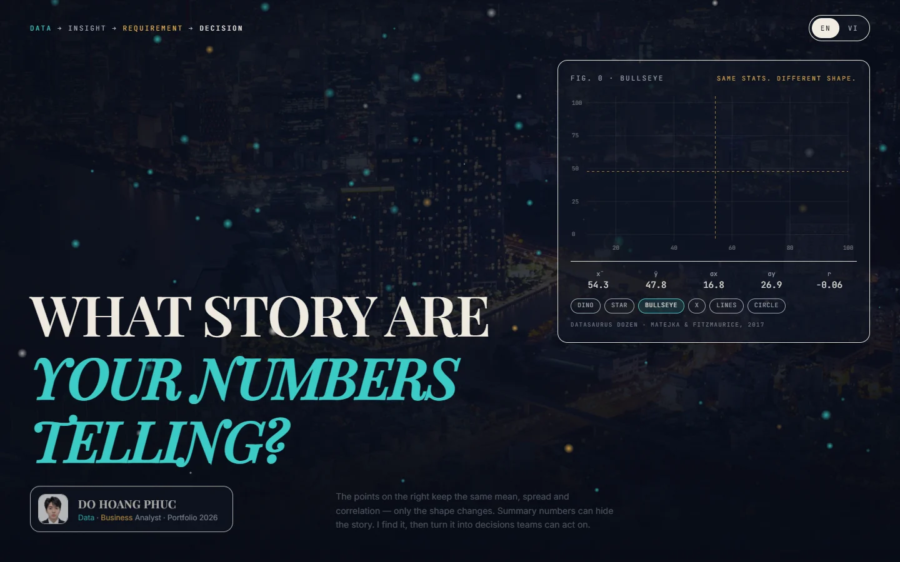

<div align="center">

# Do Hoang Phuc — Data & Business Analyst Portfolio

**From question to decision.** A bilingual (EN / VI) portfolio built to show how I find the numbers — and the needs behind them.

### [dohoangphuc.vercel.app](https://dohoangphuc.vercel.app/)

[LinkedIn](https://www.linkedin.com/in/dohoangphuc0606/) · [Email](mailto:dhp06062005@gmail.com) · [GitHub](https://github.com/HoangPhucTony)

[](https://dohoangphuc.vercel.app/)




</div>

---

## About

I'm a Management Information Systems student at the University of Transport Ho Chi Minh City (UTH, GPA 3.64/4.0), currently a **Business Analyst intern** at Saigon International General Hospital (SIG) and the Public Transport Management Center (MCPT).

This site is my portfolio for **Data Analyst** and **Business Analyst** roles at **Intern or Fresher** level. Every page is built around one idea: a good analysis starts with the right question and ends with a decision someone can act on.

## Highlights

- **Two portfolios in one.** A Data Analyst / Business Analyst switch filters the projects, recolors the page (teal for DA, amber for BA) and can be linked directly, so each application gets the right view.
- **Case studies, not just cards.** Each project has its own page: context, step-by-step process, screenshots, outcome and lessons learned.
- **Bilingual.** Every word exists in English and Vietnamese; the choice is remembered and can be set by link (`?lang=en` / `?lang=vi`).
- **A cover that makes the point.** The opening screen animates the *Datasaurus Dozen*: datasets with identical mean, spread and correlation but completely different shapes. Summary numbers can hide the story.
- **Experience as a timeline,** with a details pop-up for each role that links to the related case studies.
- **Confidential by design.** Work done for real organizations is shown without their figures (see [Data & privacy](#data--privacy)).
- **Polished but accessible.** Smooth scrolling, magnetic buttons, cursor-lit cards and 3D tilt, all switched off when the visitor prefers reduced motion. One layout scales to every desktop size, with a dedicated mobile layout.

## Featured case studies

| Case study | Track | What it shows |
|---|---|---|
| **What really drives imaging and lab revenue** | Data Analyst | Variance analysis with the chain substitution method: revenue split into six drivers, drilled down by specialty and doctor |
| **Promotion analysis: where does the discount money go?** | Data Analyst | First task at SIG: SQL exploration and a MECE issue tree to find where promotion spend is concentrated, then ANOVA and regression on its link with revenue |
| **Corporate health checks, from contract to payment** | Business Analyst | End-to-end process across four departments, turned into a Google Apps Script web app for the CEO and FP&A with email-based access |
| **Student mental health, from sensor data to decisions** · *University Project* | Data Analyst | Team coursework at UTH: my Power BI layer (star schema, 24 DAX measures, four dashboards) on a SQL Server warehouse, plus a QA pass that fixed six data errors |
| **Retail purchasing, from store shortage to supplier order** · *University Project* | Business Analyst | Team coursework at UTH: BPMN AS-IS / TO-BE and fit-gap for a retail chain's purchasing, turned into three Odoo 19 modules with a live demo |

Each one lives at `/projects/<slug>` (`sig-revenue-drivers`, `sig-promotion-analysis`, `sig-kskdn-dashboard`, `uth-student-mental-health`, `uth-mis-purchasing`).

## Tech stack

| Area | Tools |
|---|---|
| Framework | React 18, TypeScript, Vite 5 |
| Styling | Tailwind CSS 3, custom design tokens (dark theme, role-based accent colors) |
| Motion | Framer Motion, Lenis smooth scrolling |
| Routing | React Router 6 (home + one page per case study) |
| Icons and type | Lucide, Playfair Display, Inter, JetBrains Mono |
| Hosting | Vercel |

## Getting started

Requires Node.js 18 or later.

```bash
npm install
npm run dev       # http://localhost:5173
npm run build     # type-check and production build into dist/
npm run preview   # serve the production build locally
```

## Project structure

```
src/
├── data/
│   ├── profile.ts       # all personal content: bio, experience, projects (EN + VI)
│   ├── ui.ts            # interface labels (EN + VI)
│   └── datasaurus.ts    # Datasaurus Dozen points for the cover
├── sections/            # About, Experience (timeline), Projects, Contact
├── pages/               # Home and the case-study page
├── components/          # Intro cover, sidebar, project card, shared UI
├── hooks.ts             # role / language URL sync, smooth scroll, scroll lock
└── i18n.tsx             # language context
public/images/           # photos, logos and case-study screenshots (WebP)
```

## Editing content

All content lives in `src/data/profile.ts`; no component changes are needed. Every text is a pair `{ en: "...", vi: "..." }`.

- **Add a project:** append an object to `profile.projects` with a `slug`, `role: "da" | "ba"`, four `facts`, the `process` steps, a `gallery` and an `outcome`. Put screenshots in `public/images/projects/`. A `note` field shows a disclaimer above the cover. `university: true` tags coursework as a University Project and lists it in its own group under the role tab.
- **Experience:** `profile.experience`. `highlights` appear in the "View details" pop-up and `caseStudies` lists the related project slugs.
- **CV and cover letter:** files live in `public/cv/`. `profile.cv` holds each role's PDF, `profile.cvPreview` the page images shown in the preview pop-up, and `profile.coverLetter` the letter text (EN / VI) with its PDFs. A role without a CV keeps its button, which says the CV is not ready yet.

## Deployment

The site is a static Vite build, deployed on Vercel:

1. Import this repository at [vercel.com/new](https://vercel.com/new). The **Vite** preset is detected automatically (build `npm run build`, output `dist`).
2. Every push to `main` redeploys.

`vercel.json` rewrites all routes to `index.html`, so case-study URLs such as `/projects/sig-kskdn-dashboard` work on refresh.

**Links for applications:**

- Data Analyst view: [dohoangphuc.vercel.app/?role=da&lang=en#projects](https://dohoangphuc.vercel.app/?role=da&lang=en#projects)
- Business Analyst view: [dohoangphuc.vercel.app/?role=ba&lang=en#projects](https://dohoangphuc.vercel.app/?role=ba&lang=en#projects)
- One case study: [dohoangphuc.vercel.app/projects/sig-kskdn-dashboard](https://dohoangphuc.vercel.app/projects/sig-kskdn-dashboard)

## Data & privacy

The case studies come from real internship work, so no confidential figures are published:

- No revenue amounts, rates or row counts from the hospital appear in the text.
- Spreadsheet screenshots are blurred so that only headings, column names and formulas remain readable.
- Dashboard screenshots were taken from a local copy of the app running on **scrambled demo data** (contracts removed, every amount randomised), and money amounts are blurred on top of that. The page says so above the images.

## Credits

- **Datasaurus Dozen**: Justin Matejka & George Fitzmaurice, *Same Stats, Different Graphs* (CHI 2017). Data from the R package [`datasauRus`](https://github.com/jumpingrivers/datasauRus) (MIT).
- **Photos** (Unsplash License): CreateTravel.tv (cover, `dtu842bEZuw`), Duc Nguyen (skyline, `JWsTkxzrh48`), Tron Le (Landmark 81, `eilpDNi_pV4`).

## Contact

**Do Hoang Phuc**, Ho Chi Minh City
[dhp06062005@gmail.com](mailto:dhp06062005@gmail.com) · [LinkedIn](https://www.linkedin.com/in/dohoangphuc0606/)

Open to Data Analyst and Business Analyst roles at Intern or Fresher level (on-site, hybrid or remote).

---

<details>
<summary><b>Tóm tắt tiếng Việt</b></summary>

Portfolio song ngữ (Anh / Việt) của **Đỗ Hoàng Phúc**, sinh viên Hệ thống thông tin quản lý (UTH), dùng để ứng tuyển vị trí **Intern / Fresher** **Data Analyst** và **Business Analyst**.

- **Chạy thử:** `npm install`, rồi `npm run dev` và mở http://localhost:5173.
- **Sửa nội dung:** chỉ cần sửa `src/data/profile.ts`. Mỗi chuỗi có dạng `{ en, vi }`, không phải đụng tới component.
- **CV & thư xin việc:** file đặt trong `public/cv/`; khai báo đường dẫn ở `profile.cv`, ảnh xem trước ở `profile.cvPreview`, nội dung thư ở `profile.coverLetter`. Role chưa có CV vẫn hiện nút, bấm vào sẽ báo "Chưa có CV".
- **Thêm dự án:** thêm một object vào `profile.projects`, ảnh đặt trong `public/images/projects/`.
- **Deploy:** import repo vào Vercel, framework Vite. Mỗi lần push lên `main` web tự cập nhật.
- **Bảo mật:** không công bố số liệu thật của SIG. Ảnh Sheet đã làm mờ; ảnh dashboard chụp từ dữ liệu giả lập và đã che số tiền.

</details>
